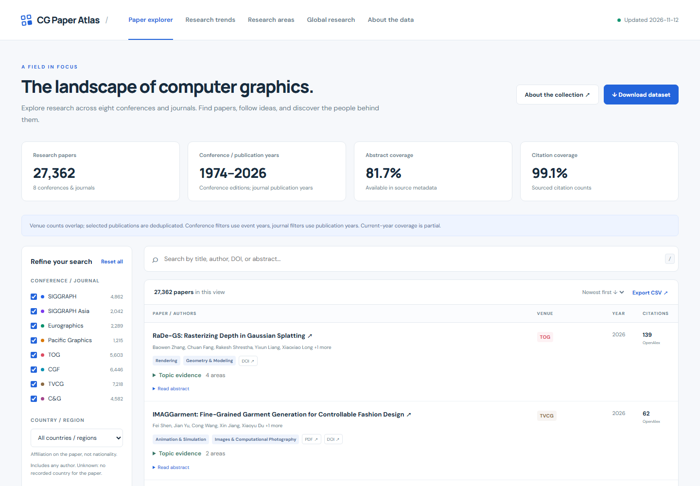

# CG Paper Atlas

Computer Graphics 논문 **27,362편**을 검색하고 연구 분야와 소속 국가별 동향을 살펴보는 정적 웹사이트입니다.

[웹사이트](https://oweixx.github.io/cgpaper-atlas/) · [Research areas](https://oweixx.github.io/cgpaper-atlas/?view=research) · [Global research](https://oweixx.github.io/cgpaper-atlas/?view=world)



## 확정한 범위

- 학회: **SIGGRAPH, SIGGRAPH Asia, Eurographics, Pacific Graphics**의 정규 연구논문. SIGGRAPH의 Journal/Conference 두 Technical Papers 트랙을 모두 포함합니다.
- 저널: **ACM TOG, Computer Graphics Forum(CGF), TVCG, Computers & Graphics**의 연구논문과 리뷰. 다른 학회와 연계된 이 저널의 특집호도 포함합니다. 그 학회 자체를 독립적으로 추가 수집하지는 않습니다.
- PG 2005–2006의 The Visual Computer 게재 논문은 PG에 속하므로 포함합니다. The Visual Computer 전체를 포함하는 것은 아닙니다.
- 포스터·데모·강좌·스케치·서문·편집글·정정·세션 소개 등은 제외합니다. TOG 36(4)의 특정 1쪽 발표 레코드도 별도 신규 연구논문으로 세지 않습니다. Survey/review는 제목 기반 자동 분류이며 별도 필터를 제공합니다.
- 수집 기간은 확보 가능한 과거 자료부터 현재까지입니다. 현재 연도는 미완성 집계이며, 연구 분석 기본 기간은 2018–2025입니다.

## 데이터 현황

Snapshot 생성: **2026-11-12T15:40:36.530980+00:00**. 실제 수집 시각은 출처 ledger에 별도로 기록합니다.

| Venue | Indexed years | Memberships | Abstracts | Citations |
|---|---:|---:|---:|---:|
| SIGGRAPH | 1974–2026 | 4,862 | 95.7% | 98.9% |
| SIGGRAPH Asia | 2008–2025 | 2,042 | 98.2% | 99.9% |
| Eurographics | 1980–2026 | 2,289 | 93.9% | 93.4% |
| Pacific Graphics | 1997–2025 | 1,215 | 93.5% | 99.7% |
| TOG | 1982–2026 | 5,603 | 99.6% | 99.4% |
| CGF | 1982–2026 | 6,446 | 94.4% | 97.9% |
| TVCG | 1995–2026 | 7,218 | 99.7% | 99.8% |
| C&G | 1975–2026 | 4,582 | 7.4% | 99.8% |

**위 행의 논문 수를 합산하면 안 됩니다.** 6,895편은 여러 venue에 속합니다. 예를 들어 SIGGRAPH/TOG 논문은 양쪽 필터에 나타나지만 전체 합계에서는 한 번만 셉니다. 전체 고유 논문은 **27,362편**입니다.

- 학회 필터는 개최연도, 저널 필터는 서지정보의 출판연도를 사용합니다. 두 연도를 `venue_years`와 `publication_year`에 보존합니다. 여러 venue를 함께 선택하면 표시 순서에서 먼저 일치한 학회, 그다음 저널을 기준으로 연도를 정합니다.
- 누적 막대그래프는 같은 우선순위로 논문 한 편을 한 번만 배치합니다. 저널 색상 부분은 이미 학회에 배치한 논문을 제외한 수치입니다. 연도별 표의 각 venue 열은 해당 venue 전체 논문 수입니다.
- `No indexed papers`는 자료 미확보를 뜻하며 미개최를 의미하지 않습니다. PG 1993–1996 등 초기 자료는 해당 출처에 논문 단위 색인이 없을 수 있습니다.
- SIGGRAPH Asia 2026은 DBLP 행사 목록에 아직 없으며, TOG 최신호의 관련 논문이 저널 항목에만 나타날 수 있습니다. 확인되지 않은 행사 연결은 임의로 붙이지 않습니다.
- CGF·TVCG·C&G의 시각화, XR, 기타 응용 연구도 저널 범위에 포함됩니다. 순수 렌더링 연구만을 나타내는 통계가 아닙니다.

## 기능과 계산 기준

논문·저자·DOI·초록 검색, venue·연도·국가·인용수·논문 유형 필터, XLSX/CSV/JSONL 내보내기, 10개 CG 연구 분야와 30개 세부 주제, 연도별 논문 비중, 국가별 고유 저자 수와 세계지도를 제공합니다.

**Country / region**은 논문에 기록된 저자 소속 국가를 선택합니다. 선택한 국가 소속 저자가 한 명 이상 있으면 포함하며, 다국적 공동연구와 학회/저널 중복 논문은 검색 결과에서 한 번만 셉니다. `Unknown affiliation`은 모든 저자의 국가가 없거나 소속 자료와 연결되지 않은 논문입니다. 국가·검색어·venue·연도·주제·인용 수·정렬 조건은 URL로 공유할 수 있고, 필터된 CSV에 소속 국가 코드와 이름을 포함합니다. 국가 자료 로딩 실패 시 선택을 유지하고 재시도할 수 있습니다. [한국 소속 논문 보기](https://oweixx.github.io/cgpaper-atlas/?country=KR).

전체 구현과 데이터의 개선 우선순위는 [검토 기록](docs/REVIEW.md)을 참고하세요.

주제는 **제목·문맥을 고려한 초록 규칙·OpenAlex 의미 키워드**를 결합한 `cg-topics-v3.0`으로 분류합니다. OpenAlex 키워드는 저자가 지정한 정답이 아니라 모델의 예측입니다. 논문마다 **Topic evidence**에서 분야·세부 분야, 근거 문구, 출처와 버전을 확인할 수 있습니다. 미분류는 **4,000편**이며 억지로 분야를 부여하지 않습니다. 필터 CSV와 전체 다운로드에도 분야·세부 분야·분류 버전을 포함합니다.

분류기 확정 후 별도 64편에서 분야 단위 micro-F1은 기존 58.4%에서 68.8%로 개선됐습니다. 이 표본은 개발자와 동일한 AI가 검토했으며 **독립 전문가 정답셋이나 전체 정확도 추정치가 아닙니다**. 세부 주제의 정확도는 별도로 검증하지 않았습니다. [방법과 한계](docs/TOPIC_CLASSIFICATION.md), [평가 원본](data/topic_validation.json), [분류 변화·커버리지](data/topic_classification_audit.json)를 공개합니다.

한 논문이 여러 주제에 속하므로 주제별 비중 합계는 100%를 넘을 수 있습니다. 비중의 분모는 선택한 전체 논문 수입니다. 국가별 주제 비중의 분모는 선택 기간·venue에서 해당 국가 소속이 확인된 전체 논문 수입니다.

국가 정보: **25,526/27,362편 (93.3%)**. 소속 국가가 알려진 고유 OpenAlex 저자 ID는 **34,576개**입니다. 국적이 아닌 논문 당시 기관 소속입니다. 저자 ID로 중복을 제거하며 여러 국가의 소속이 있는 저자는 각 국가에서 집계합니다. 국가 합계는 더할 수 없습니다. 기관 본사 위치, 소속 연결 오류, 저자 식별 오류, 시대별 정보량 차이의 영향을 받을 수 있습니다. 불명확한 소속은 이름으로 추정하지 않습니다. OpenAlex의 첫 100개 authorship 제한에 걸렸을 가능성이 있는 논문은 0편입니다.

인용수는 **OpenAlex 전체 색인의 인용수**입니다. CG 내부 인용수나 Google Scholar 인용수가 아닙니다. 정확한 DOI가 일치할 때만 적용하며 출처·조회 날짜를 기록합니다. 미확보는 `null`/N/A, 반환된 0은 0입니다. 초록과 PDF 링크도 확보된 항목만 제공합니다. PDF 자체는 저장·재배포하지 않습니다.

## 수집과 재현

DBLP의 8개 stream을 전체 페이지 수와 고유 레코드 수까지 대조하고, Crossref의 4개 저널 ISSN 전체 journal-article 목록을 별도로 대조합니다. 저널과 학회를 DOI로 통합합니다. DOI 없는 레코드는 정규화된 정확한 제목·전체 저자 목록·공유 venue·인접 출판연도를 모두 만족하는 유일한 후보만 병합합니다. 서로 다른 DOI의 학회 원본·저널 확장판은 유지합니다.

DBLP의 SIGGRAPH 2003 기본 컨테이너는 실제로 Sketches & Applications이고 SIGGRAPH Asia 2019 기본 컨테이너 중 하나는 Courses이므로 명시적으로 제외합니다. DBLP에 수록된 한 저널 issue의 모든 논문이 같은 학회로 연결되고 최소 5편의 근거가 있거나, 공식 학회 사이트에서 정확한 volume/issue를 지정한 근거가 있을 때 그 issue의 Crossref 레코드에도 학회를 부여합니다. SIGGRAPH 2026의 TOG 45(4)는 공식 출판 안내로 확인했습니다. [issue 근거](data/issue_mapping.json), [연도 근거](data/year_audit.json), [제외 내역](data/excluded.json), [전체 수집 ledger](data/coverage.json)를 보존합니다.

출처 색인 전체를 받았다는 것은 역사상 출판된 모든 논문이 색인되어 있다는 뜻이 아닙니다. 명시한 범위의 확보된 출판물에 대한 통계입니다.

```sh
pip install -r requirements.txt
python pipeline/collect_dblp.py
python pipeline/collect_crossref.py
python pipeline/build_cg.py --draft
# Set OPENALEX_API_KEY in the process environment when authenticated quota is needed.
python pipeline/collect_openalex.py
python pipeline/collect_topics.py
python pipeline/build_cg.py
python pipeline/evaluate_topics.py --reference topic_reference_holdout.json --output data/topic_validation.json
python -m unittest discover -s pipeline -p test_cg.py
python pipeline/validate_cg.py
python -m http.server 8767 --bind 127.0.0.1
```

원본 HTTP 응답은 `.cache/cg/`에 캐시하며 Git에서 제외합니다. 공개 snapshot만으로 `python pipeline/build_cg.py`를 실행하면 오프라인 재생성이 가능합니다. 인증 키는 환경변수에서만 읽고 요청 헤더로 보내며 저장소·ledger·웹사이트에 저장하지 않습니다. 재수집하려면 해당 요청의 로컬 캐시를 갱신해야 합니다. 자동 재수집 일정은 설정하지 않았습니다.

## 검증과 배포

단위 테스트는 학회/저널 중복, 개최연도, 부속 프로그램 제외, 보수적 식별자 병합, 분류와 다국적 소속 계산을 검증합니다. 데이터 검증은 출처별 수집 완료 여부, 고유 DOI, 소속 통계, venue별 합계와 CSV/HTML 링크를 대조합니다.

```sh
pip install -r requirements-dev.txt
python -m playwright install chromium
python pipeline/smoke_browser.py --base-url http://127.0.0.1:8767/ --output-dir .cache/qa
```

공개 저장소 `main`에 push하면 GitHub Actions 검증 후 Pages에 배포합니다. 사이트에는 웹 파일·조회용 데이터·다운로드만 포함하고 인증 정보나 HTTP 캐시는 포함하지 않습니다.

## 출처와 프로젝트 이력

- [DBLP](https://sparql.dblp.org/), [Crossref](https://www.crossref.org/), [OpenAlex](https://openalex.org/).
- [SIGGRAPH 출판 규칙](https://s2026.siggraph.org/program/technical-papers/), [CGF 공식 설명](https://www.eg.org/wp/eurographics-publications/cgf/).
- 세계지도: [Natural Earth, public domain](https://www.naturalearthdata.com/about/terms-of-use/).
- [CV Paper Atlas](https://github.com/oweixx/cvpaper-atlas)의 UI와 파이프라인을 CG용으로 확장한 별도 저장소입니다. 원형 프로젝트: [gisbi-kim/robopaper-atlas](https://github.com/gisbi-kim/robopaper-atlas). 원형의 별도 라이선스가 확인되지 않아 새 이용 허락을 주장하지 않습니다. 논문·초록·외부 자료는 각 권리자의 이용 조건을 따릅니다.
